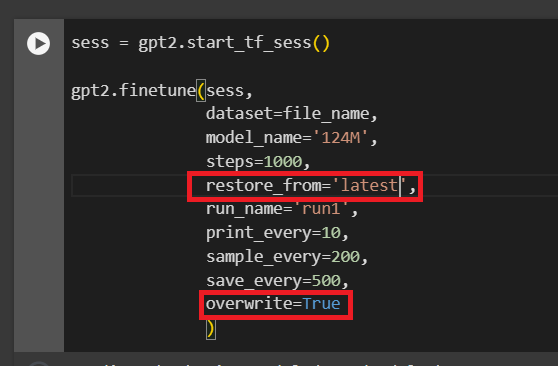

# Training GPT-2 Small

1. Create an account at [Google Colab](https://colab.research.google.com)

   * Unless you have access to a good cluster of GPUs, training even the most basic GPT-2 model can be very time consuming and expensive

   * Google Colab offers free access to GPUs and TPUs, which can be used to train GPT-2 models

2. Access the [Collaborative notebook](https://colab.research.google.com/drive/1VLG8e7YSEwypxU-noRNhsv5dW4NfTGce)

3. Log in with your account

4. upload to your google drive root the `shakespeare.txt` file in the project folder.

5. Follow the steps in the notebook to train a GPT-2 model with the sample data provided

   * Pick the smallest model available (`124M`) for this exercise
   
   * Use the sample data (`"shakespeare.txt"`) saved in your google drive to train the model

6. Fine-tune the model until it reaches a `loss` under `2.0`

   *  Modify the parameter `restore_from` to `'latest'` and add `overwrite=True` if you want to continue finetuning an existing model without creating duplicate copies
     
     

7. Generate some text from the new pre-trained model
