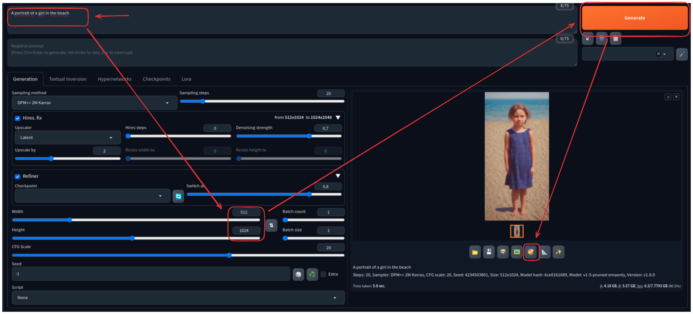
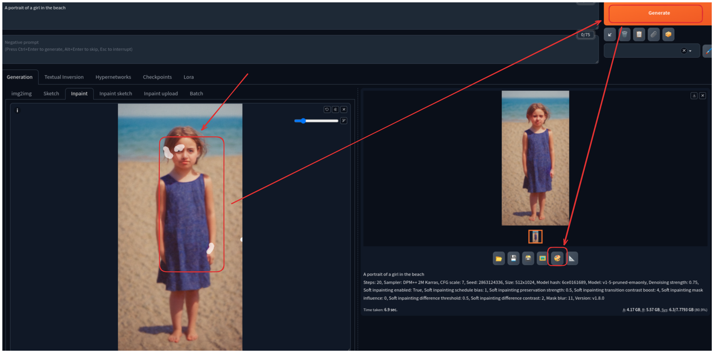

# Generate a Portrait Image

1. Generate a portrait image using the Stable Diffusion WebUI

   * Use the prompt `A portrait of a girl on the beach`

   * Configure the width and height to `512x1024`

   * Click on the `Generate` button

   * Wait until the image is generated

   * Click in the in the pallet icon to send the image to the inpaint tab

   * 

2. Use the `inpainting feature` to fix flaws and/or make changes in the face generated

   * In the right corner of the inpaint tab, click on the `use brush` button
   
   * Use the brush to select imperfections in the image and then click in the `Generate` button

   * Analyze the result and repeat the process by clicking on the palette icon to send the fixed image to the inpaint tab again if it was not satisfactory

   * 
