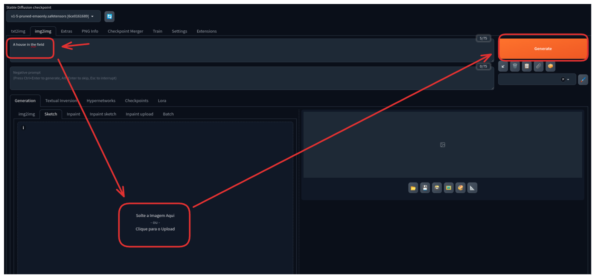

# Generate a Picture from a Sketch

1. Generate a picture from a sketch using the Stable Diffusion WebUI

   * Use the prompt `A house in the field`

   * Draw a crude sketch of a house in the field and upload it on the sketch tab

   * Click on the `Generate` button, see the result and adjust the prompt if needed

   * 
