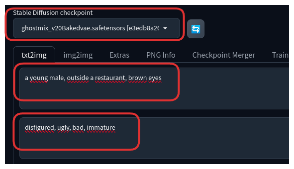
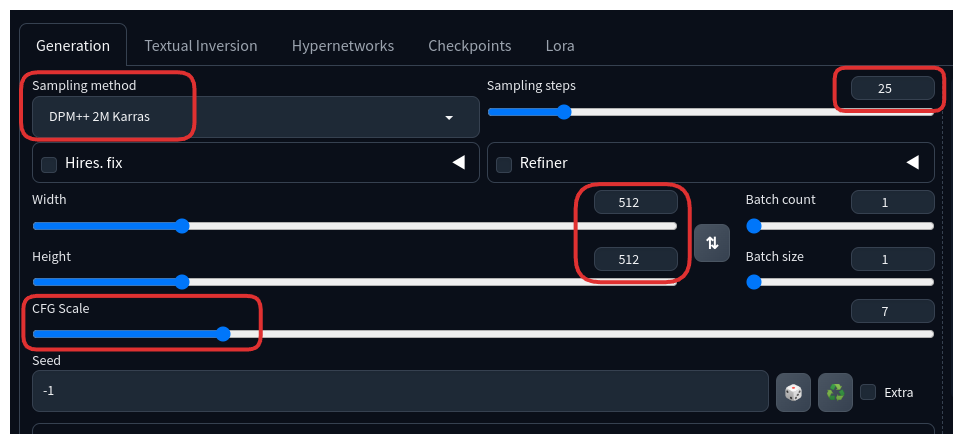
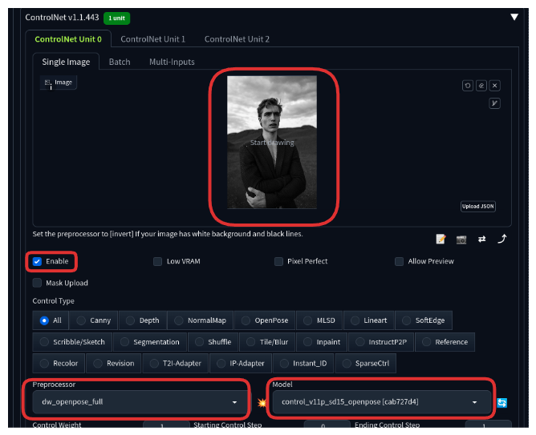
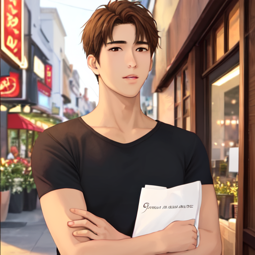

# Generating an image with a specify human pose using ControlNet

1. Download a model to use as `Stable Diffusion checkpoint`

   * Download `Ghostmix` model [here](https://civitai.com/api/download/models/76907?type=Model&format=SafeTensor&size=pruned&fp=fp16)
  
   * Place the downloaded file in the `stable-diffusion-webui/models/Stable-diffusion` directory

2. Download a model to use with `ControlNet openpose` preprocessor

   * Download `control_v11p_sd15_openpose.pth` model [here](https://huggingface.co/lllyasviel/ControlNet-v1-1/resolve/main/control_v11p_sd15_openpose.pth?download=true)
  
   * Place the downloaded file in the `stable-diffusion-webui/extensions/sd-webui-controlnet/models` directory

3. Select the model to use as the `Stable Diffusion checkpoint`

   * Click on the refresh icon and select `Ghostmix`. This will set the model that we downloaded in step 1 as the `Stable Diffusion checkpoint`
     
   * Use `a young male, outside a restaurant, brown eyes` as the prompt and `ugly, disfigured, low quality, nsfw, bad, immature` as the negative prompt

   * 

4. Use the following settings in the `Generation` tab:

   * Sampling Method: DPM++ 2M Karras

   * Sampling Steps: 25

   * Width: 512

   * Height: 512

   * CFG Scale: 7
   
   * 

5. Configure ControlNet

   * On the text2img page, expand the ControlNet section. You should see an empty image canvas under ControlNet Unit 0 > Single Image.

   * Upload the `pose.jpg` file located inside the `images` folder of this directory

     * 
  
   * Mark the `Enable` checkbox

   * Use the following settings:

      * Preprocessor: Dw_openpose_full

      * ControlNet Model: Control_v11p_sd15_openpose [cab727d4]

      * 

6. Press the `Generate` button to view the result

      * Example:

      * 
