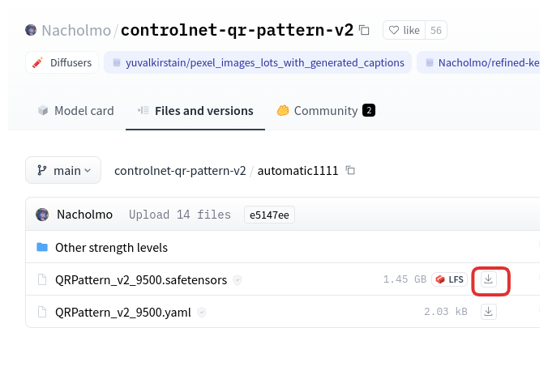
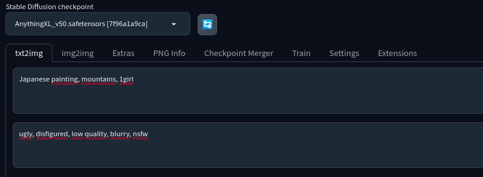
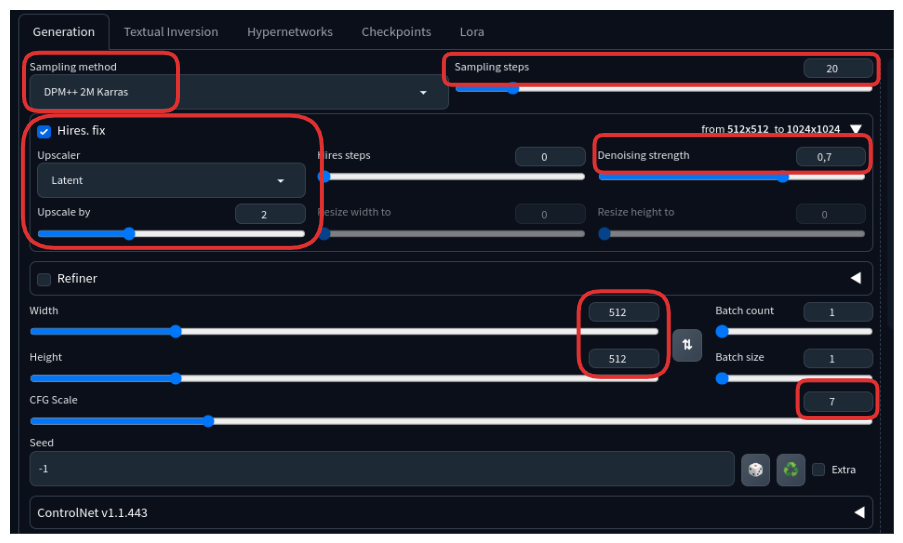
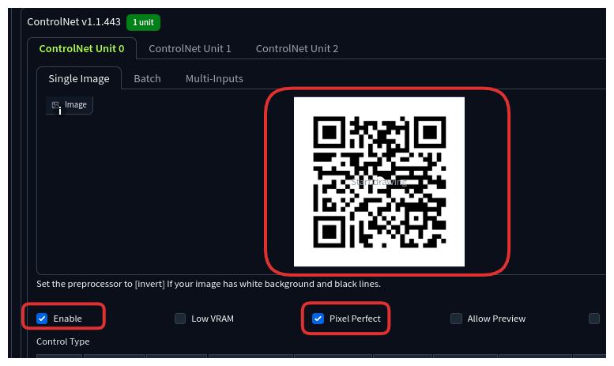
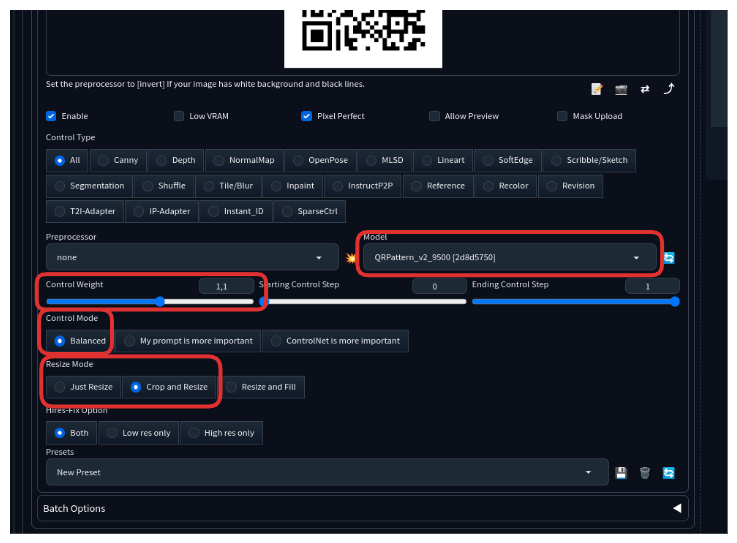
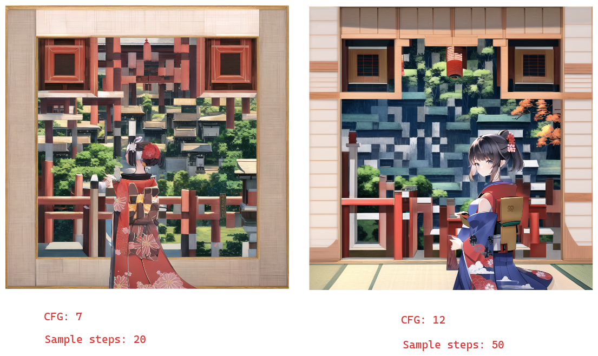

# Generating a QRCode with a ControlNet

1. Download an anime model to use as Stable Diffusion checkpoint

   * Download `Anything v5` model [here](https://civitai.com/api/download/models/30163)
  
   * Put the downloaded file in your models folder located at `stable-diffusion-webui/models/Stable-diffusion`
  
2. Download the QR code control model

   * Download the QR code control model [here](https://huggingface.co/Nacholmo/controlnet-qr-pattern-v2/tree/main/automatic1111) by clicking on the download icon of the file finished in `.safetensors`
  
   * Put the downloaded file in ControlNet models folder located at `stable-diffusion-webui/extensions/sd-webui-controlnet/models`

   * 

3. Select the model and enter the text-to-image setting

   * Click on the refresh icon and then select `Anything v5`, it will set the model that we downloaded in step 1 as the `Stable Diffusion checkpoint`
     
   * Use `Japanese painting, mountains, 1girl` as the prompt and `ugly, disfigured, low quality, blurry, nsfw` as the negative prompt

   * 

4. Generate a QR code

   * Generate a QR code using the default options of this [site](https://www.qr-code-generator.com/)
  
5. Use the following settings in the `Generation` tab:

   * Sampling Method: DPM++ 2M Karras
   * Sampling Step: 20
   * Hires Fix: On – Upscaler: Latent. Upscale by 2. Denoising strength: 0.7
   * Width: 512
   * Height: 512
   * CFG Scale: 7
   * 
  
6. Upload the QR code image

   * On the text2img page, expand the ControlNet section. You should see an empty image canvas under ControlNet Unit 0 > Single Image.

   * Upload the QR code to the Image Canvas
  
   * Mark the `Enable` and `Pixel perfect` checkboxes

   * 

7. Use the following settings in the same `ControlNet` tab that you uploaded the QR code image:

   * ControlNet Model: QRPattern_v2_9500 [2d8d5750]
   * Control Weight: 1.1 (This needs to be adjusted for each prompt)
   * Control Mode: Balanced
   * Resize Mode: Crop and Resize
   * 
  
8. Press the generate button and see the result

9. Experiment by changing:

   * Prompts

   * Cfg: How many times to improve the generated image iteratively; higher values take longer; very low values can produce bad results

   * Samples steps: How strongly the image should conform the prompt - lower values produce more creative results

   * 
