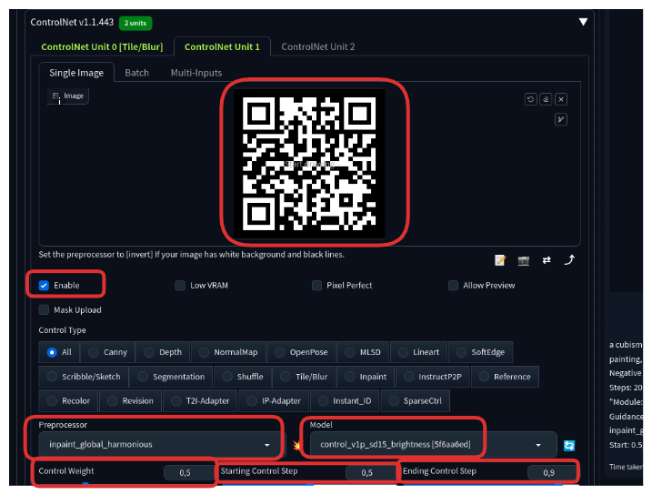

# Generating a QRCode with ControlNet extension
  
1. Download the `Brightness Control` model

   * Download the Brightness Control model [here](https://huggingface.co/ioclab/ioc-controlnet/resolve/main/models/control_v1p_sd15_brightness.safetensors)
  
   * Put the downloaded file in ControlNet models folder located at `stable-diffusion-webui/extensions/sd-webui-controlnet/models`

2. Select the model and enter the text-to-image setting

   * Click on the refresh icon and select `Ghostmix` (the same model we used in the previous exercise)
     
   * Use `a cubism painting of a town with a lot of houses in the snow with a sky background, Andreas Rocha, matte painting concept art, a detailed matte painting, blurry, blurry_background, blurry_foreground, depth_of_field` as the prompt and `ugly, disfigured, low quality, nsfw` as the negative prompt

   * 

3. Generate a QR code

   * Generate a QR code using this [site](https://qr.io/). It is recommended to invert the colors (white foreground and black background) to create a more aesthetically pleasing image

   * 
  
4. Use the following settings in the `Generation` tab:

   * Sampling Method: Euler a
   * Sampling Steps: 20
   * Width: 512
   * Height: 512
   * CFG Scale: 7
   * 
  
5. Configure ControlNet unit 0

   * On the text2img page, expand the ControlNet section. You should see an empty image canvas under ControlNet Unit 0 > Single Image.

   * Upload the QR code to the Image Canvas
  
   * Mark the `Enable` checkbox

   * Use the following settings:

      * Control Type: Tile/Blur

      * Preprocessor: Tile resample

      * ControlNet Model: Control_v1p_sd15_brightness [5f6aa6ed]

      * Control Weight: 0.5

      * Starting Control Step: 0.15

      * Ending Control Step: 0.5

      * 

6. Configure ControlNet unit 1

   * Upload the QR code to the Image Canvas
  
   * Mark the `Enable` checkbox

   * Use the following settings:

      * Preprocessor: Inpaint_global_harmonious

      * ControlNet Model: Control_v1p_sd15_brightness [5f6aa6ed]

      * Control Weight: 0.5

      * Starting Control Step: 0.5

      * Ending Control Step: 0.9

      * 
  
7. Press the `Generate` button to view the result

      * Example:

      * 
