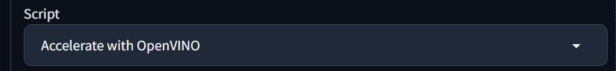

# Implementing Computer Vision in an Application

## Install Stable Diffusion WebUI

1. Clone the repository from GitHub:

   ```bash
   git clone https://github.com/AUTOMATIC1111/stable-diffusion-webui
   ```

2. If you don't own a GPU, download from this repository:

   ```bash
   git clone https://github.com/openvinotoolkit/stable-diffusion-webui.git
   ```

3. Change to the `stable-diffusion-webui` directory:

4. Before setting up the Stable Diffusion WebUI, ensure that you have the necessary dependencies installed. Detailed instructions for various hardware configurations can be found here:

- [NVidia GPUs](https://github.com/AUTOMATIC1111/stable-diffusion-webui/wiki/Install-and-Run-on-NVidia-GPUs)
- [AMD GPUs](https://github.com/AUTOMATIC1111/stable-diffusion-webui/wiki/Install-and-Run-on-AMD-GPUs)
- [Intel Silicon](https://github.com/openvinotoolkit/stable-diffusion-webui/wiki/Installation-on-Intel-Silicon)
- [Apple Silicon](https://github.com/AUTOMATIC1111/stable-diffusion-webui/wiki/Installation-on-Apple-Silicon)
- [Running in Docker Containers](https://github.com/AUTOMATIC1111/stable-diffusion-webui/wiki/Containers)
- [Running in Online Services](https://github.com/AUTOMATIC1111/stable-diffusion-webui/wiki/Online-Services)
- Clip Interrogator Extension must be installed: [Clip Interrogator Extension](https://github.com/pharmapsychotic/clip-interrogator-ext)

5. Installation:

Follow the instructions provided in the [README](https://github.com/AUTOMATIC1111/stable-diffusion-webui?tab=readme-ov-file#installation-and-running) to install and run the Stable Diffusion WebUI.

6. To start using the Stable Diffusion WebUI successfully follow the steps below:

Configure the `COMMANDLINE_ARGS` accordingly:

- Use `--skip-torch-cuda-test` if you don't have a GPU.
- Use `--api` to enable the API.
- Use `--cors-allow-origins *` to allow connections from any origin.
- If you don't have a GPU you should also select the option below:
  

After configuration, access the WebUI at [http://127.0.0.1:7860/](http://127.0.0.1:7860/).

## Create Your Next.js Project

7. Create your project:

   ```bash
   npx create-next-app my-ai-app
   ```

8. Choose all default options.

9. Navigate to the created folder:

   ```bash
   cd my-ai-app
   ```

10. Create a file to hold our navbar component.

- In the root of your project, find the `app` folder and create a new file inside it named `navbar.tsx`.

- Open the `navbar.tsx` file and paste the code:

```javascript
import Link from "next/link";

const Navbar = () => {
  return (
    <nav>
      <ul className="flex gap-10 py-5 px-3 bg-black/5 font-bold">
        <li>
          <Link href="/stable-diffusion">
            <p className="text-black/80">Stable Diffusion</p>
          </Link>
        </li>
        <li>
          <Link href="/text-generation">
            <p className="text-black/80">Text Generation</p>
          </Link>
        </li>
      </ul>
    </nav>
  );
};

export default Navbar;
```

11. Integrate the navbar into your existing layout.

- Inside the `app` folder, find the `layout.tsx` file and access it.

- Modify the RootLayout component to include the navbar and wrap the page content with it. This way, the navbar will always be shown. It will look like this:

```javascript
import type { Metadata } from "next";
import { Inter } from "next/font/google";
import "./globals.css";
import Navbar from "./navbar";

const inter = Inter({ subsets: ["latin"] });

export const metadata: Metadata = {
  title: "Create Next App",
  description: "Generated by create next app",
};

export default function RootLayout({
  children,
}: Readonly<{
  children: React.ReactNode,
}>) {
  return (
    <html lang="en">
      <body className={inter.className}>
        {/* Include the Navbar component */}
        <Navbar />
        {/* Render the page content */}
        {children}
      </body>
    </html>
  );
}
```

12. Create a new folder to hold our page layout and our logic.

- In the root of your project, find the `app` folder and create a new folder inside it named `stable-diffusion`.

- Inside the `stable-diffusion` folder create a `page.tsx` file and access it.

- At the top of the file, import the `useState` hook:

```javascript
import { useState } from "react";
```

13. Define the initial state of the variables we'll be using.

- base64String will be used to store the uploaded image in base64 format, allowing us to display a preview of the uploaded image.
- Description will be used to store the generated description of the uploaded image.
- isLoading will control de loading state of the application. When set to true, it indicates that the application is in the process of making an API call to generate the image description.

```javascript
export default function Home() {
  const [base64String, setBase64String] = useState("");
  const [description, setDescription] = useState("");
  const [isLoading, setIsloading] = useState(false);
}
```

14. Paste inside the `page.tsx` file this function that handles the files uploaded to the page:

```javascript
const handleFileInputChange = (event: any) => {
  const file = event.target.files[0];
  if (file) {
    const reader = new FileReader();
    reader.onloadend = () => {
      const base64Data = reader.result;
      if (base64Data) setBase64String(base64Data.toString());
    };
    reader.readAsDataURL(file);
  }
};
```

15. Paste inside the `page.tsx` file this function that handles the image description generation:

```javascript
const generateDescription = async () => {
  setIsloading(true);
  const response = await fetch("http://127.0.0.1:7861/interrogator/prompt", {
    method: "POST",
    headers: {
      "Content-Type": "application/json",
    },
    body: JSON.stringify({
      image: base64String,
      clip_model_name: "ViT-L-14/openai",
      mode: "fast",
    }),
  });
  const data = await response.json();
  setDescription(data.prompt);
  setIsloading(false);
};
```

16. Return the JSX structure for the component:

```javascript
return (
  <div>
    {/* History display */}
    {/* Loading indicator */}
    {/* Input field and button */}
  </div>
);
```

17. Display input and image preview:

- Include an input element of type file to upload images, with an onChange event handler to manage changes in file input.
- Conditionally exhibit the image preview upon availability of a base64 string.
- The image preview is displayed within an img element, with the src attribute assigned the base64 string.

  ```javascript
  <div className="mb-5 flex flex-col">
    <input className="mb-5" type="file" onChange={handleFileInputChange} />
    {base64String && (
      <div className="mb-5">
        
      </div>
    )}
  </div>
  ```

18. Create send button:

- Add a button element for sending the image data to generate a description.
- Use Tailwind CSS classes to style the button with a background color, padding, text color, rounded corners, and a shadow.
- The button is disabled if no base64 string is available or if the component is in a loading state.

  ```javascript
  <button
    className="bg-blue-500 w-20 p-2 text-white rounded shadow-xl disabled:bg-blue-500/20"
    onClick={generateDescription}
    disabled={!base64String || isLoading}
  >
    Send
  </button>
  ```

19. Display description:

- Display the generated description below the file input and image preview.

  ```javascript
  <p className="font-bold">Description</p>
  <p>{description}</p>
  ```

20. Display loading indicator

- Conditionally show a loading indicator if the component is currently in a loading state.

  ```javascript
  {
    isLoading && <p>Loading...</p>;
  }
  ```

21. Now all that's left is for you to test the AI's image description.
